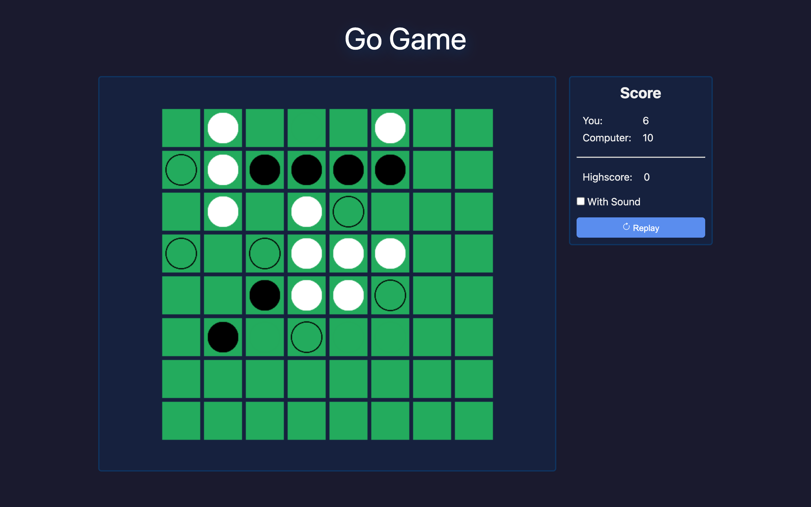

# ⚫ Go Game

An **Othello** board game rendered on an HTML canvas. You play against a simple bot, with live scores and a high score.



> Part of the **one-day-one-code** repo — see the full catalog in [`../index.html`](../index.html).

## Run

Open `index.html` directly in a browser — no install needed.

## API

```javascript
let othello = new Othello({
  canvas,
  playerColor,
  playerScoreEl,
  botScoreEl,
  highScoreEl
});
othello.render();
```

## Tech

HTML + CSS + Vanilla JS (`js/Board.js`, `js/Othello.js`, `js/main.js`), no framework.
