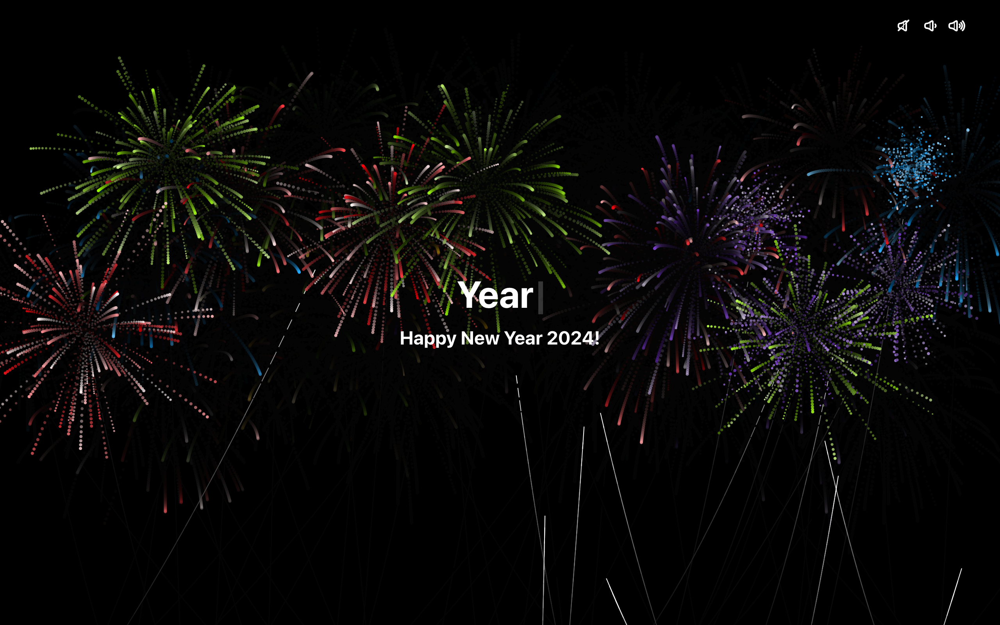

# 🎆 New Year Countdown 2024

A **New Year 2024 countdown** with a fireworks particle background and a typewriter greeting. The target date is hard-coded in `src/App.js` to 1 January 2024, so it now shows the finished state unless you change the date.



> Part of the **one-day-one-code** repo — see the full catalog in [`../index.html`](../index.html).

## Run

Needs Node.js:

```bash
npm install
npm start   # http://localhost:3000
```

## Tech

React (Create React App), Tailwind CSS, react-countdown, react-particles with tsparticles-preset-fireworks, react-simple-typewriter.
