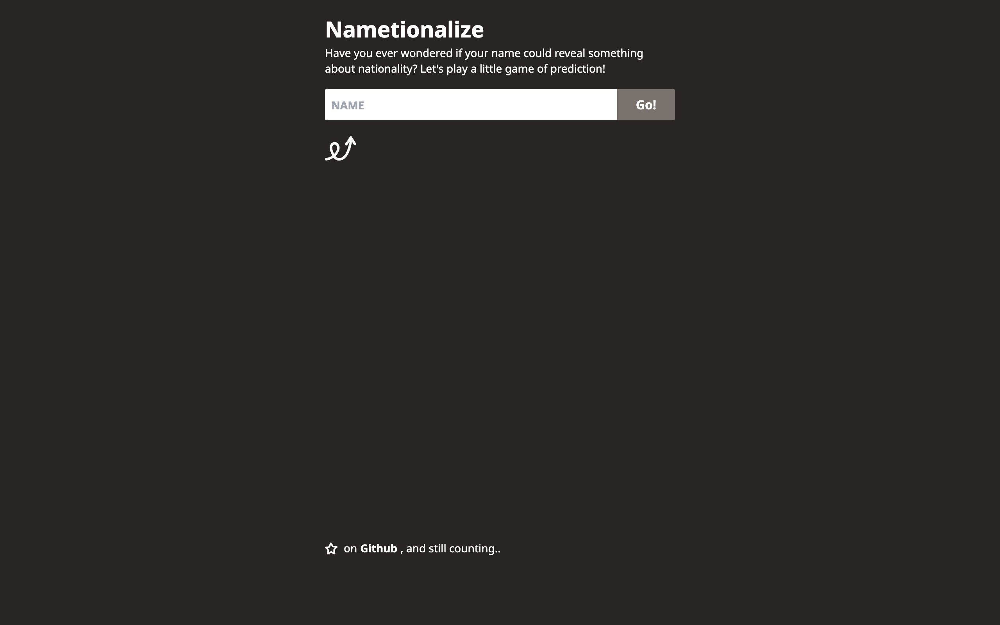

# 🌍 Nametionalize

Type a name and see the countries it most likely comes from, with probabilities and flags.



> Part of the **one-day-one-code** repo — see the full catalog in [`../index.html`](../index.html).

## Run

Needs Node.js:

```bash
npm install
npm run dev   # http://localhost:3000
```

## Tech

Next.js, TypeScript, Tailwind CSS. Data comes from [Nationalize](https://nationalize.io/) and flags from [Flag CDN](https://flagcdn.com/).
