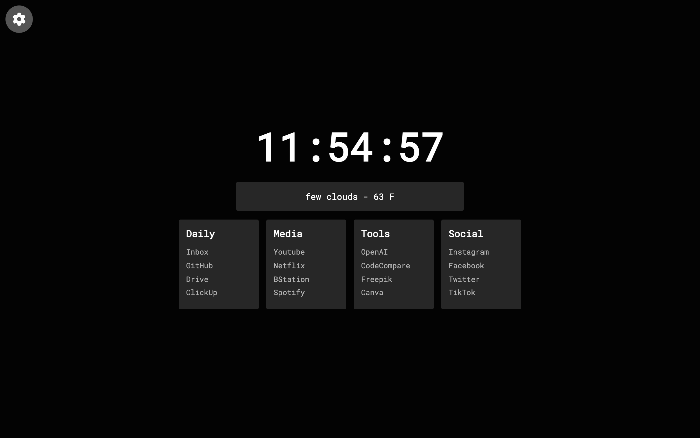

# 🔖 Simple Homepage

A minimal **browser start page** with grouped bookmarks.

> Part of the **one-day-one-code** repo — see the full catalog in [`../index.html`](../index.html).

## Run

Open `index.html` directly in a browser, or set it as your browser's homepage.

## Customize

Bookmarks live in `bookmarks.js` as an array of `{ title, links: [{ name, url }] }` objects. The layout expects **4** sections.

## Tech

HTML + CSS + Vanilla JS, no dependencies.
