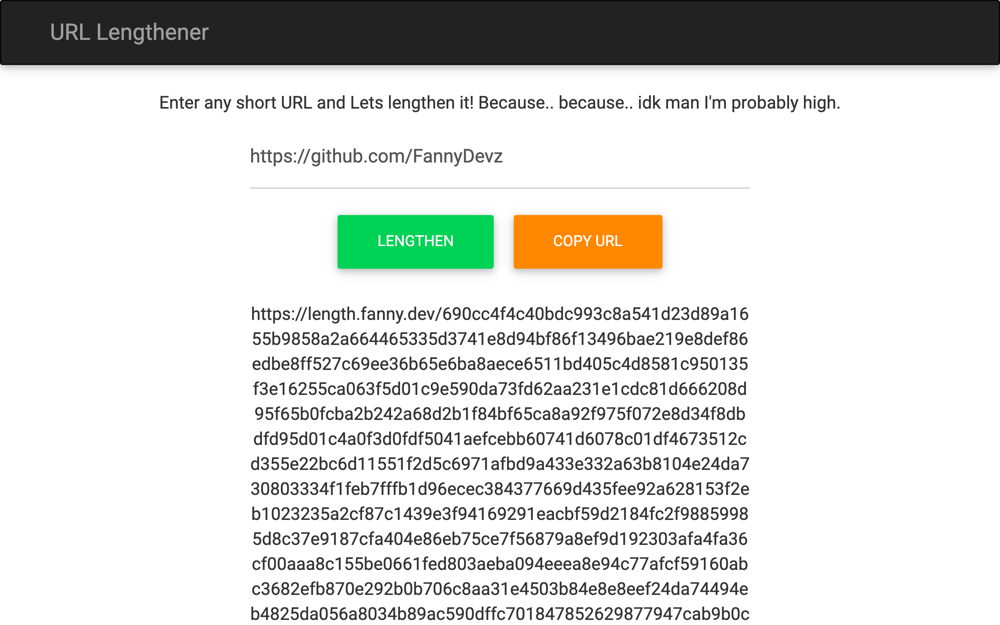

# 🔗 URL Lengthener

The **opposite of a URL shortener**: it turns a link into a random 10,000-character URL that redirects to the original.



> Part of the **one-day-one-code** repo — see the full catalog in [`../index.html`](../index.html).

## Run

Needs Node.js:

```bash
npm install
node app.js   # http://localhost:3000
```

## Tech

Node.js + Express. Mappings are saved to `urls.json`, which starts empty.
