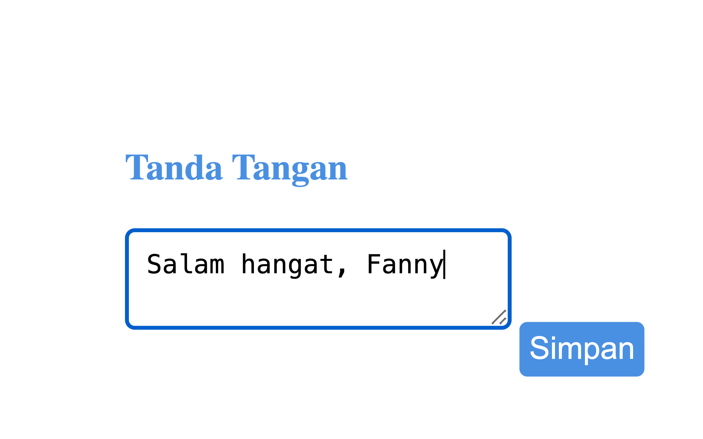

# 💬 WhatsApp Digitalku

A **Chrome extension** for WhatsApp Web that adds a button to copy the current chat's phone number, plus a popup.

> Part of the **one-day-one-code** repo — see the full catalog in [`../index.html`](../index.html).

## Run

1. Open `chrome://extensions` and turn on **Developer mode**.
2. Click **Load unpacked** and pick this folder.
3. Open [WhatsApp Web](https://web.whatsapp.com/).

## Tech

Chrome Extension Manifest V3: a content script, a background service worker, and a popup.
