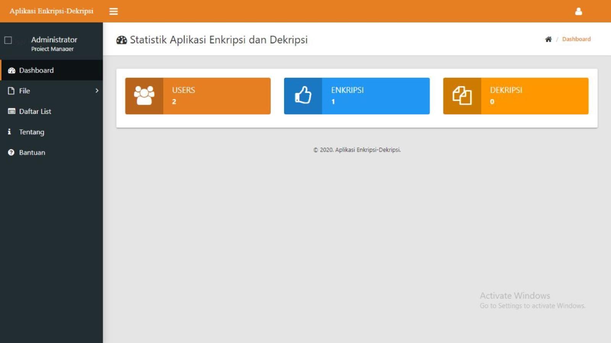

# 🔐 AES File Encryption

A **PHP dashboard** for encrypting and decrypting files with AES-128, with login and history pages. It's a learning project for the algorithm, so don't use it to protect real data.

> Part of the **one-day-one-code** repo — see the full catalog in [`../index.html`](../index.html).

## Run

Requires **PHP 5** (it uses the removed `mysql_*` functions) and MySQL with a database named `endek_aes`. The database schema is **not included**, so it can't run as is. Connection settings are in `config.php`.

## Tech

PHP + MySQL, with the AES implementation in `dashboard/AES.php`. Uploaded files go in `dashboard/file_encrypt` and `dashboard/file_decrypt`.
