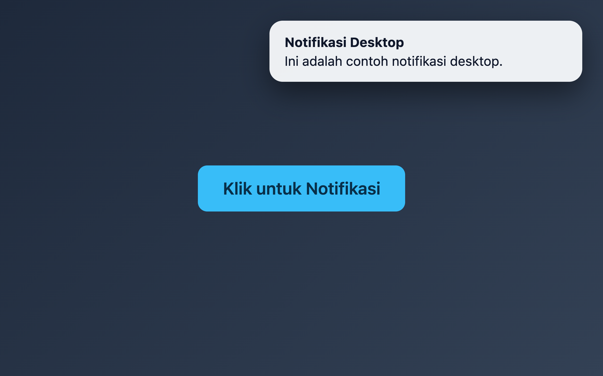

# 🔔 Desktop Notification

A one-button demo of the browser Notification API: it asks for permission, then shows a desktop notification.



> Part of the **one-day-one-code** repo — see the full catalog in [`../index.html`](../index.html).

## Run

Open `index.html` directly in a browser, or use a local server:

```bash
python3 -m http.server 8000   # http://localhost:8000
```

## Tech

Single-file HTML + Vanilla JS, using the Notification API.
