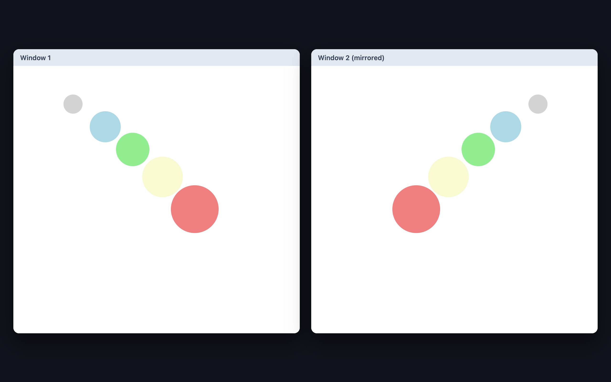

# 🟣 Mirrored Circles

Coloured circles trail the mouse, and BroadcastChannel mirrors their movement in other open windows of the same page.



> Part of the **one-day-one-code** repo — see the full catalog in [`../index.html`](../index.html).

## Run

Open `index.html` directly in a browser, or use a local server:

```bash
python3 -m http.server 8000   # http://localhost:8000
```

Open the page in two windows to see the mirroring.

## Tech

Single-file HTML + CSS + Vanilla JS, using the BroadcastChannel API.
