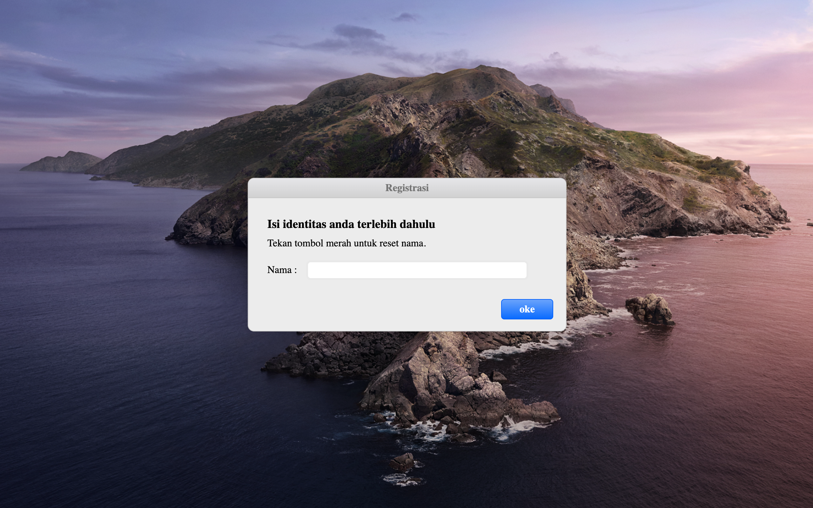

# 💌 Somebody to You

An **interactive love-confession page**: enter a name, read the message, and answer yes or no, with music, video, and a draggable window.



> Part of the **one-day-one-code** repo — see the full catalog in [`../index.html`](../index.html).

## Run

Open `index.html` through a local server. It needs an internet connection for its CDN libraries:

```bash
python3 -m http.server 8000   # http://localhost:8000
```

## Tech

Single-file `index.html` with jQuery from a CDN, plus local audio, video, and images. The entered name is kept in `localStorage`.
