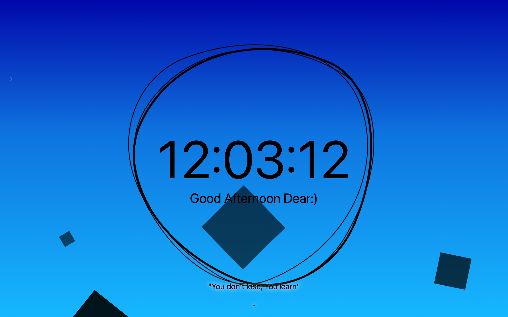

# 🌅 For You Homescreen

A **browser homescreen** with a clock and a background that follows the time of day. You can also pick a style by hand, such as Ubuntu, Dawn, Noon, Sunset, Midnight, or RGB.



> Part of the **one-day-one-code** repo — see the full catalog in [`../index.html`](../index.html).

## Run

Open `index.html` through a local server. It needs an internet connection for its CDN libraries:

```bash
python3 -m http.server 8000   # http://localhost:8000
```

## Tech

Single-file `index.html` with jQuery, Bootstrap, Spectrum, and Baffle from CDNs. Settings are kept in `localStorage`.
