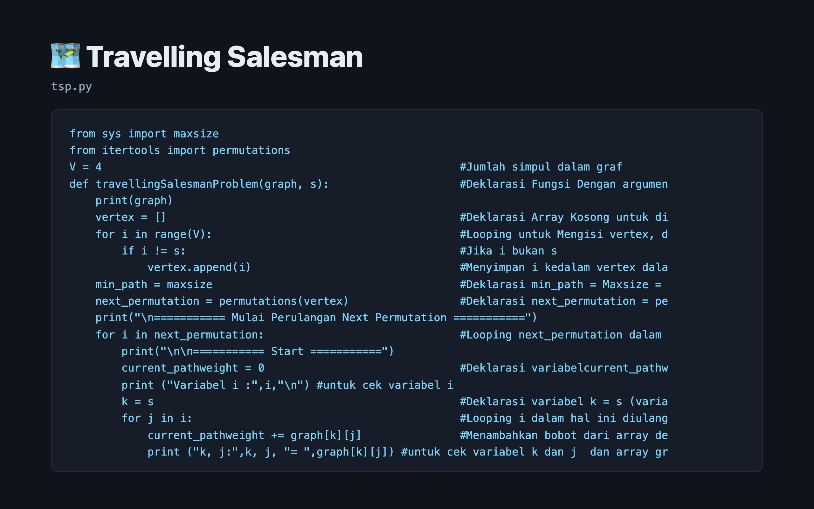

# 🗺️ Travelling Salesman

A brute-force Travelling Salesman solver that tries every route through a 4-node graph and prints each step.



> Part of the **one-day-one-code** repo — see the full catalog in [`../index.html`](../index.html).

## Run

```bash
python3 tsp.py
```

## Tech

Python standard library (`itertools.permutations`).
