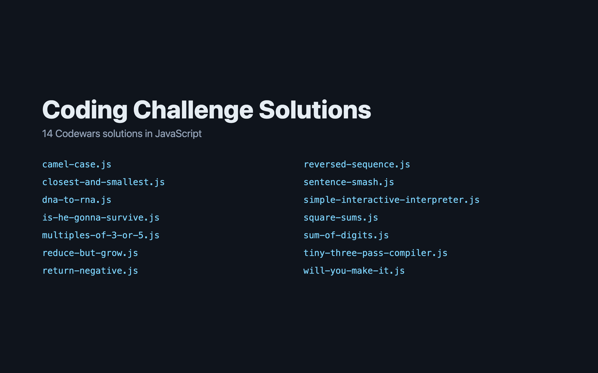

# 🧩 Coding Challenge Solutions

JavaScript solutions to 14 coding challenges, from Sum of Digits and Sentence Smash to a Tiny Three-Pass Compiler and a simple interactive interpreter.



> Part of the **one-day-one-code** repo — see the full catalog in [`../index.html`](../index.html).

## Challenges

| Challenge | File | What it does |
| --- | --- | --- |
| [Closest and Smallest](https://www.codewars.com/kata/5868b2de442e3fb2bb000119) | `closest-and-smallest.js` | Takes a string of numbers and finds the two whose digit-sum weights are closest, preferring the smallest weights. |
| [Convert String to Camel Case](https://www.codewars.com/kata/517abf86da9663f1d2000003) | `camel-case.js` | Converts dash- or underscore-separated words to camelCase. |
| DNA to RNA Conversion | `dna-to-rna.js` | Converts a DNA string to RNA by replacing every T with U. |
| [Multiples of 3 or 5](https://www.codewars.com/kata/514b92a657cdc65150000006) | `multiples-of-3-or-5.js` | Adds up all the multiples of 3 or 5 below a given number. |
| [Reduce but Grow](https://www.codewars.com/kata/57f780909f7e8e3183000078) | `reduce-but-grow.js` | Multiplies all the numbers in an array together with reduce. |
| [Return Negative](https://www.codewars.com/kata/55685cd7ad70877c23000102) | `return-negative.js` | Makes a number negative, leaving numbers that are already zero or negative unchanged. |
| [Reversed Sequence](https://www.codewars.com/kata/5a00e05cc374cb34d100000d) | `reversed-sequence.js` | Builds an array counting down from n to 1. |
| [Sentence Smash](https://www.codewars.com/kata/53dc23c68a0c93699800041d) | `sentence-smash.js` | Joins an array of words into one sentence separated by spaces. |
| [Sum of Digits](https://www.codewars.com/kata/541c8630095125aba6000c00) | `sum-of-digits.js` | Adds up a number's digits repeatedly until only one digit is left. |
| [Tiny Three-Pass Compiler](https://www.codewars.com/kata/5265b0885fda8eac5900093b) | `tiny-three-pass-compiler.js` | A small compiler for arithmetic functions, split into three passes that parse the program, reduce it, and generate code. |
| [Will You Make It?](https://www.codewars.com/kata/5861d28f124b35723e00005e) | `will-you-make-it.js` | Checks whether the fuel left is enough to reach the pump. |
| [Is He Gonna Survive?](https://www.codewars.com/kata/59ca8246d751df55cc00014c) | `is-he-gonna-survive.js` | Checks whether a hero has enough bullets for the dragons, at two bullets per dragon. |
| [Simple Interactive Interpreter](https://www.codewars.com/kata/simple-interactive-interpreter) | `simple-interactive-interpreter.js` | An interpreter for a small language with its own tokenizer and parser, plus variables and functions. |
| [Square Sums](https://www.codewars.com/kata/5a667236145c462103000091) | `square-sums.js` | Arranges the numbers from 1 to n so that each adjacent pair adds up to a perfect square. |

## Run

Each file stands alone:

```bash
node sum-of-digits.js
```

These files define a solution but print nothing when run, so load them in Node.js or a browser console to call them: `closest-and-smallest.js`, `multiples-of-3-or-5.js`, `tiny-three-pass-compiler.js`, `simple-interactive-interpreter.js`, `square-sums.js`.

## Tech

Plain JavaScript, one file per challenge.
