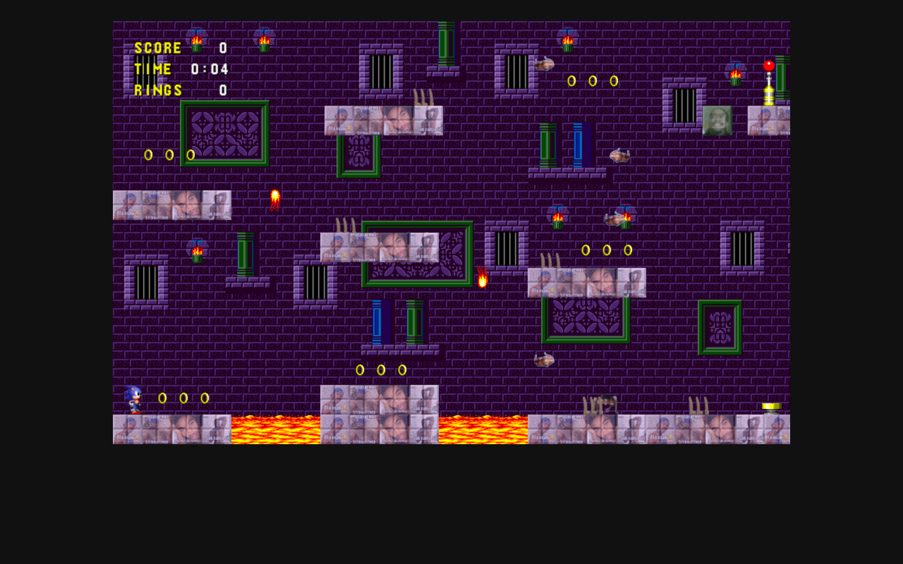

# Sonic the Jomox Game



A browser platformer built with Phaser, reskinned with edited assets for Reza Auditore. This is a fan project based on another developer's game, not an original work.

## How to play

| Key | Action |
| --- | --- |
| Left Arrow | Move left |
| Right Arrow | Move right |
| Up Arrow | Jump |

## Run

```bash
cd "37. sonic-the-jomox-game" && python3 -m http.server 8000
```

Then open http://localhost:8000.

## Credits

- **Original game and code:** [rzencoder/sonic-hedgehog-game](https://github.com/rzencoder/sonic-hedgehog-game) by rzencoder.
- **This version:** asset edits by [FannyDevz](https://github.com/FannyDevz), made for Reza Auditore. Source: [FannyDevz/sonic-the-jomox-game](https://github.com/FannyDevz/sonic-the-jomox-game).
- **Sonic the Hedgehog** is a trademark of SEGA. This is an unofficial fan project, not affiliated with or endorsed by SEGA.

The upstream repository does not declare a license, so no license is granted here.
