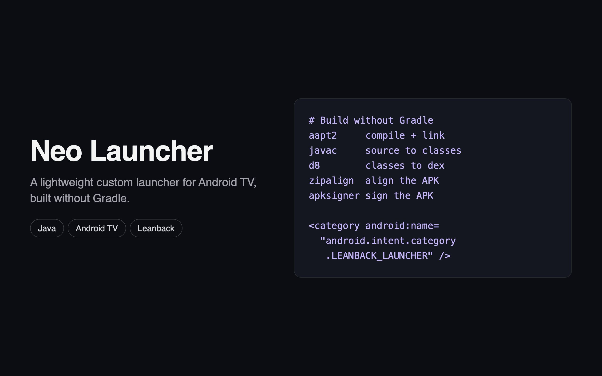

# Neo Launcher



A lightweight custom launcher for Android TV, written in plain Java and built without Gradle. It registers as a Leanback and Home launcher and includes a service that opens Neo Launcher when the Google home screen appears.

## Build

Requires the Android SDK build tools and a JDK. `build.sh` runs `aapt2`, `javac`, `d8`, `zipalign`, and `apksigner`.

```bash
export NEO_KS_PASS="choose-your-own-password"
./build.sh
```

The script creates `neo.keystore` if it does not exist. The signing key and built APK are not included in this repository, so keep your own keystore safe: updates must be signed with the same key.
