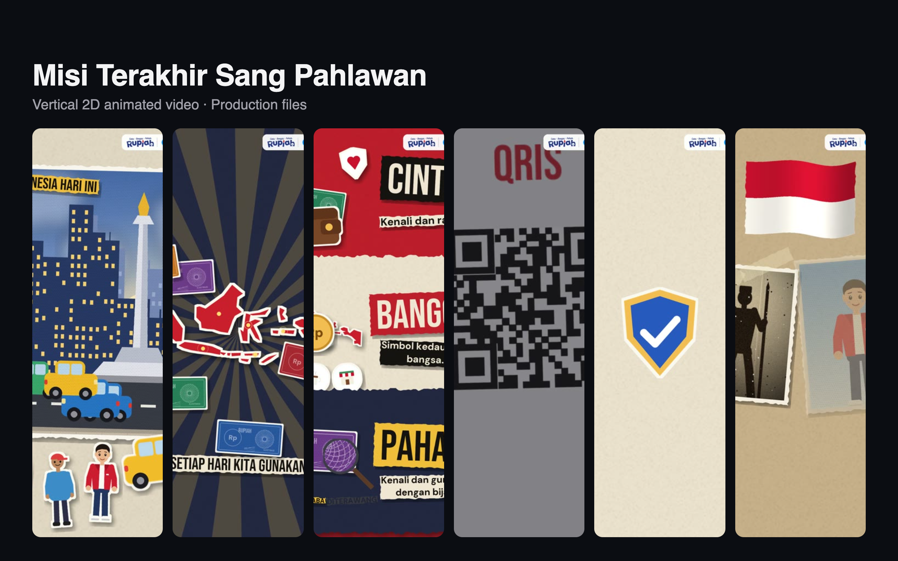

# Misi Terakhir Sang Pahlawan

Production files for a vertical (1080×1920) 2D animated video made for the Bank Indonesia creative video competition, themed around heroes, love of the Rupiah, and wise transactions.

## What's here

| Path | Contents |
| --- | --- |
| `storyboard.md` | Scene-by-scene storyboard |
| `naskah_voiceover_elevenlabs.md` | Voice-over script |
| `audio/` | Voice-over tracks |
| `style_samples/` | Visual style explorations |
| `build/` | Python render scripts, stills, and contact sheets |
| `informasi_lomba_video_kreatif_bank_indonesia.md` | Competition brief |

The final video and intermediate video and WAV renders are not included. The render scripts use paths from the original machine, so update them and install `ffmpeg` before re-rendering.
