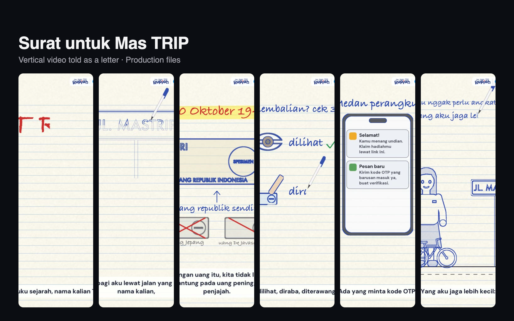

# Surat untuk Mas TRIP

Production files for a vertical (1080×1920) video made for the Bank Indonesia creative video competition. A high school student in Surabaya in 2026 writes a letter to "Mas TRIP", a student soldier from 1946, and the whole voice-over is that letter.

## What's here

| Path | Contents |
| --- | --- |
| `TREATMENT.md` | Creative treatment and story structure |
| `FAKTA.md` | Fact notes |
| `naskah_voiceover_elevenlabs.md` | Voice-over script |
| `audio/` | Voice-over tracks |
| `style_samples/` | Visual style explorations |
| `build/` | Python render scripts |
| `informasi_lomba_video_kreatif_bank_indonesia.md` | Competition brief |

The final video and intermediate video and WAV renders are not included. The render scripts use paths from the original machine, so update them and install `ffmpeg` before re-rendering.
