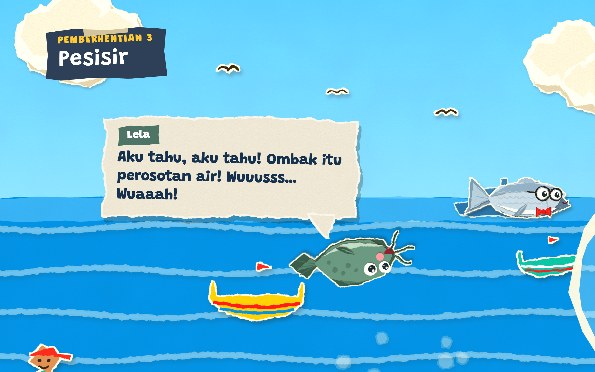

# Bandi & Lela Keliling Lamongan



A 4-minute 2D animated story in Indonesian, made for a PGRI Kabupaten Lamongan competition. Two fish, Bandi and Lela, tour the places and food of Lamongan. The animation is hand-coded in HTML, SVG, and JavaScript and plays directly in the browser with voices, music, and sound effects.

## Run

```bash
cd "42. bandi-lela-keliling-lamongan" && python3 -m http.server 8000
```

Open http://localhost:8000 and press **Putar**.

## What's here

| Path | Contents |
| --- | --- |
| `index.html` | The animation and its player |
| `suara/` | Mixed dialog, music, and sound-effect tracks, plus individual dialog lines |
| `foto/` | Food photos used in the story |
| `desain/` | Character and font explorations |
| `alat/` | Scripts for audio and export |
| `naskah-elevenlabs/`, `naskah-rekaman.md` | Voice scripts |

The exported video and the original music files are not included, so scripts in `alat/` that need them will not run as is.

## Credits

- **Created by:** Tryas Sukmaning Sakti, SMPN 1 Karangbinangun
- **Illustration and animation:** Claude
- **Character voices:** ElevenLabs
- **Music (Pixabay Content License):** "Happy Ukulele (Version 2)" by BombinSound, modern classical track by AtlasAudio, "Spirit of Bali - Indonesia Gamelan Music" by FASSounds, "Hopeful" by The_Mountain
- **Font:** Grandstander, Google Fonts (SIL Open Font License)
- **Photos:**
  - Soto Lamongan by Wiwik P, Wikimedia Commons (CC BY-SA 4.0)
  - Nasi Boran by Hidayatus Sifa, Wikimedia Commons (CC BY-SA 4.0)
  - Abon bandeng by Syakirah2020, Wikimedia Commons (CC BY 4.0)
  - Otak-otak bandeng: promotional photo by Otak-Otak Bandeng Bu Reza, Lamongan. All rights belong to the owner.
- **Logo:** PGRI
