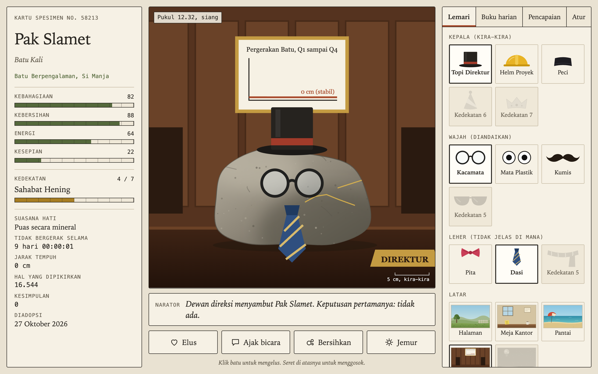

# Pelihara Batu Virtual



A virtual pet game about a rock. Adopt one, name it, and look after it. It does not move, and it never will. The game is in Indonesian and runs offline with no dependencies.

## How to play

Pick one of six rock types, then name your rock. Each rock is drawn from a random seed, so no two look the same.

| Action | How | Effect |
| --- | --- | --- |
| Pet (Elus) | Click the rock or the button | More happiness, less loneliness |
| Talk (Ajak bicara) | Type a message | Less loneliness. The rock replies with "..." |
| Clean (Bersihkan) | Use the button, or drag across the rock | More cleanliness. Dirt and moss build up if you don't |
| Sunbathe (Jemur) | Use the button | More energy |

## Features

- **Stats** for happiness, cleanliness, energy, and loneliness, which change in real time and while you're away
- **Seven bond levels** that unlock 12 accessories and 5 backgrounds
- **Three evolution stages**, with a title based on how you treat the rock
- **Diary** that records events and what you said to the rock
- **15 achievements**, 5 of them secret
- **Letter from the rock** when you come back after being away
- **Random events** such as ants, butterflies, and rain, plus a very rare chance that the rock moves
- **Real-time sky** that follows your clock from morning to night
- **Settings** for sound, reduced motion, renaming, and releasing the rock, which deletes its save

## Run

Open `index.html` directly, or use a local server:

```bash
cd "43. pelihara-batu-virtual" && python3 -m http.server 8000
```

Then open http://localhost:8000.

## Tech

HTML, CSS, and vanilla JavaScript. The rocks, accessories, and backgrounds are generated SVG, sounds use the Web Audio API, and progress is saved in `localStorage`.
