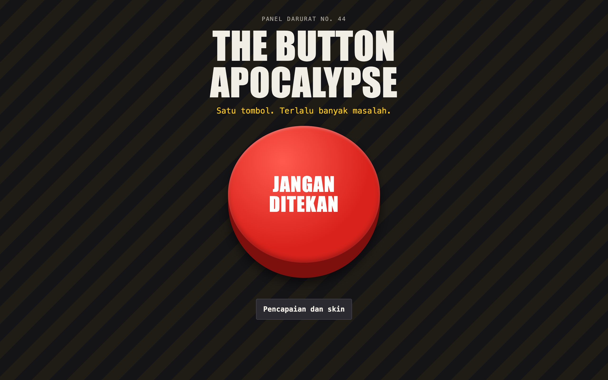

# The Button Apocalypse



An absurd arcade game about one big button that gets worse the more you press it. The game text is in Indonesian. It runs offline with no dependencies.

## How to play

Press the button. Reach 100 clicks, then beat the boss. You have 5 lives, and pressing a fake or wrong button costs one. Fast presses build a combo of up to x8.

| Clicks | Phase | What changes |
| --- | --- | --- |
| 0 | Tombol biasa | A normal button, for now |
| 15 | Tombol kabur | The button dodges your cursor, or jumps after each tap on a touchscreen |
| 30 | Tombol menciut | It shrinks with every press |
| 45 | Tombol palsu | Only the button labelled TEKAN is real |
| 65 | Aturan baru | Press by color, because the labels lie |
| 85 | Semua sekaligus | Dodging, shrinking, and fakes together |
| 100 | Tombol Terakhir | A three-stage boss, and it doesn't always stay down |

## Random events

- **Button Panic:** the button keeps jumping around
- **Button Clone:** five extra buttons appear
- **Reverse Day:** the arena turns upside down
- **Fake Victory:** you win, except you don't
- **Button Strike:** buttons stop responding for a few seconds
- **Golden Button:** a short-lived bonus worth 50 points
- **Tombol Beku:** the button freezes and takes five presses to crack
- **Hujan Tombol:** small bonus buttons fall from the top

## Features

- **Endless mode**, unlocked after beating the boss
- **11 achievements** and **6 button skins** to unlock
- **Saved progress:** high scores, achievements, skins, and lifetime stats stay in `localStorage`
- **Pause and settings:** press **P** or **Esc** to pause, and turn off sound or reduce shaking and flashing

## Run

Open `index.html` directly, or use a local server:

```bash
cd "44. the-button-apocalypse" && python3 -m http.server 8000
```

Then open http://localhost:8000.

## Tech

HTML, CSS, and vanilla JavaScript, with sounds generated by the Web Audio API.
