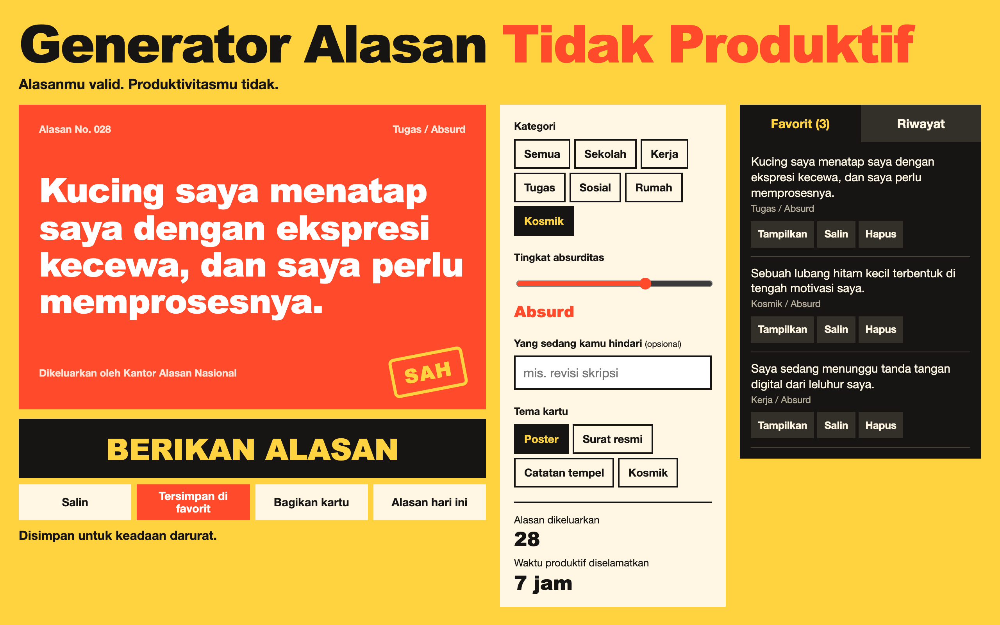

# Generator Alasan Tidak Produktif



A generator of absurd excuses for not getting things done. The excuses are written in Indonesian, and each one comes stamped as officially valid. It runs offline with no dependencies.

## How to use

Pick a category and an absurdity level, then press **Berikan alasan**. To target a specific chore, type it in and the excuse is built around it, for example "Saya belum bisa revisi skripsi karena...".

## Features

- **96 handwritten excuses** across 6 categories (school, work, assignments, social, home, and cosmic) and 4 absurdity levels
- **No quick repeats:** every matching excuse appears once before any comes back
- **Daily excuse:** one excuse per day, chosen from the date
- **Favorites and history:** both are saved in `localStorage`
- **Copy and share:** copy the text, or create a 1080×1080 PNG card to share or download
- **4 card themes:** poster, official letter, sticky note, and cosmic

## Run

Open `index.html` directly, or use a local server:

```bash
cd "45. generator-alasan-tidak-produktif" && python3 -m http.server 8000
```

Then open http://localhost:8000.

## Tech

HTML, CSS, and vanilla JavaScript. The share card is drawn with the Canvas API.
