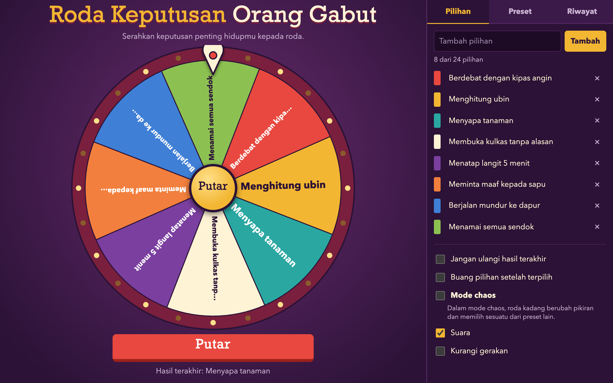

# Roda Keputusan Orang Gabut



A fairground-style decision wheel for people with nothing better to do. Use your own options or a ready-made list, then let the wheel decide. The interface is in Indonesian. It runs offline with no dependencies.

## How to use

Add options in the **Pilihan** tab, or pick a list in the **Preset** tab, then press **Putar**.

## Features

- **Editable options:** add, edit, and delete between 2 and 24 options
- **5 built-in presets:** food, activities, entertainment, chores, and absurd choices
- **Saved wheels:** name your own lists and load them later
- **No repeats (optional):** the last result can't win the next spin
- **Remove winners (optional):** each winning option leaves the wheel until 2 remain
- **Chaos mode (optional):** the wheel sometimes changes its mind and picks from another preset
- **History and sharing:** recent results are saved, and any result can be shared or copied
- **Sound and motion settings:** ticks and a fanfare, which you can turn off, plus a reduced-motion option

Options, presets, history, and settings are saved in `localStorage`.

## Run

Open `index.html` directly, or use a local server:

```bash
cd "46. roda-keputusan-orang-gabut" && python3 -m http.server 8000
```

Then open http://localhost:8000.

## Tech

HTML, CSS, and vanilla JavaScript. The wheel is drawn with the Canvas API, and sounds use the Web Audio API.

The winner is chosen before the spin starts, then the wheel's final angle is calculated to land on it.
