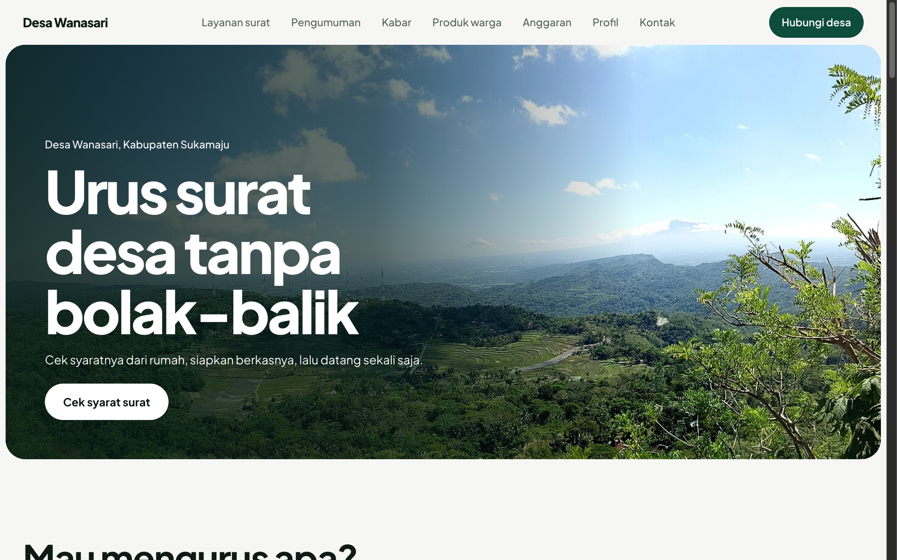

# Desa Wanasari — Public Service Village Portal



A clean, mobile-first public service portal for Desa Wanasari. Built specifically so residents can easily check document requirements, track administrative procedures, read official announcements, explore village budget transparency (APBDes), and browse local UMKM products directly from their smartphones without unnecessary trips to the village hall.

## Pages

- **Beranda (`index.html`)**: Quick access to administrative services, upcoming village events, and latest community updates.
- **Layanan Mandiri (`layanan.html`)**: Complete guide and checklist for official letters (Surat Keterangan Usaha, Domisili, SKTM, Pengantar Nikah, etc.).
- **Pengumuman (`pengumuman.html`)**: Real-time community announcements, Posyandu schedules, and communal work notices.
- **Kabar Desa (`kabar.html`)**: Grassroots journalistic stories and local community achievements.
- **Produk UMKM (`produk.html`)**: Catalog of village agriculture and craft products with direct WhatsApp ordering links.
- **Transparansi Anggaran (`anggaran.html`)**: Clear visual breakdown of village revenues, expenditures, and development allocations (APBDes).
- **Profil Desa (`profil.html`)**: History, vision, mission, demographics, and apparatus structure.
- **Kontak & Pengaduan (`kontak.html`)**: Direct contact numbers for village officials and emergency contacts.
- **Admin Dashboard (`admin.html`)**: Content management interface for village staff to update announcements and news.

## Run

Open `index.html` directly in any web browser, or serve locally:

```bash
cd "47. desa-wanasari" && python3 -m http.server 8000
```

Then open http://localhost:8000.

## Tech

Built with semantic HTML5, modern CSS3 (custom CSS variables, responsive grid & flexbox layouts, mobile-first design), and Vanilla JavaScript for interactive tabs, search filtering, and mobile menu toggles. Typography uses Plus Jakarta Sans via Google Fonts.
