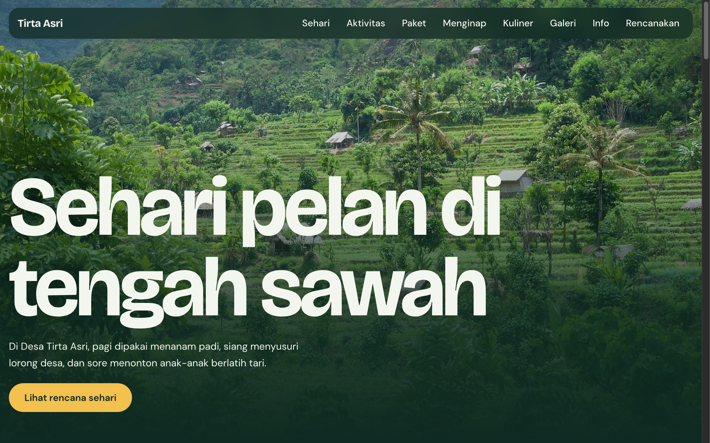

# Desa Wisata Tirta Asri — Ecotourism Village Portal



An editorial, atmospheric website for Desa Wisata Tirta Asri, promoting slow living and community-based ecotourism amidst lush green rice fields. Visitors can discover authentic village experiences, book curated activities, reserve traditional homestays, and learn about local culture.

## Pages

- **Beranda (`index.html`)**: Cinematic introduction to village life, seasonal activities, guest testimonials, and a daily itinerary showcase.
- **Aktivitas & Paket (`aktivitas.html`)**: Detailed experience packages including organic rice planting, heritage walks, pottery, and traditional dance workshops.
- **Menginap & Kuliner (`menginap.html`)**: Cozy homestays with local host families, authentic farm-to-table culinary menus, and traditional cooking classes.
- **Galeri Foto (`galeri.html`)**: Curated photo essays capturing daily life, harvest seasons, and cultural ceremonies.
- **Panduan Kunjungan (`info.html`)**: Practical traveler guide covering transportation, best visiting seasons, packing lists, and local etiquette.
- **Pemesanan (`kunjungan.html`)**: Online reservation and inquiry form for solo travelers, families, and educational tour groups.
- **Admin Panel (`admin.html`)**: Reservation dashboard for village tourism managers to track incoming bookings.

## Run

Open `index.html` directly in any web browser, or serve locally:

```bash
cd "48. desa-wisata-tirta-asri" && python3 -m http.server 8000
```

Then open http://localhost:8000.

## Tech

Built with HTML5, responsive CSS3 using a rich dark-forest palette (`#0f2a22`) with warm harvest gold accents (`#f2c14e`), and lightweight Vanilla JavaScript. Typography pairs Bricolage Grotesque for titles with DM Sans for body copy via Google Fonts.
