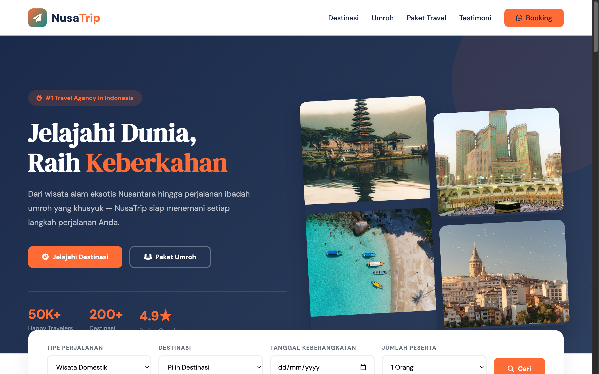

# NusaTrip — Travel & Umroh Agency



A vibrant, feature-rich landing page for a modern Indonesian travel and pilgrimage agency. Blends thrilling adventure travel packages with spiritual Umroh & Halal tour offerings in a seamless, high-converting presentation.

## Sections

- **Hero & Search Bar**: Impactful headline with quick search by destination, trip category, and departure date.
- **Popular Destinations (`#destinations`)**: Card showcase of domestic and international destinations with price tags, duration badges, and rating stars.
- **Umroh & Halal Tour (`#umroh`)**: Specialized religious pilgrimage packages with hotel star ratings, airline info, and itinerary inclusions.
- **Curated Packages (`#packages`)**: Tabbed filter for open trips, private tours, family vacations, and corporate outings.
- **Testimonials (`#testimonials`)**: Reviews and travel stories from verified travelers.
- **Booking & Consultation (`#booking`)**: Interactive booking inquiry form with instant WhatsApp consultation trigger.

## Run

Open `index.html` directly in any web browser, or serve locally:

```bash
cd "49. travel-adventure" && python3 -m http.server 8000
```

Then open http://localhost:8000.

## Tech

Single-file HTML with inline CSS and Vanilla JavaScript. Features smooth scrolling, filter tabs, interactive inquiry calculation, and responsive mobile navigation. Typography uses DM Sans and DM Serif Display via Google Fonts; icons from Font Awesome.
