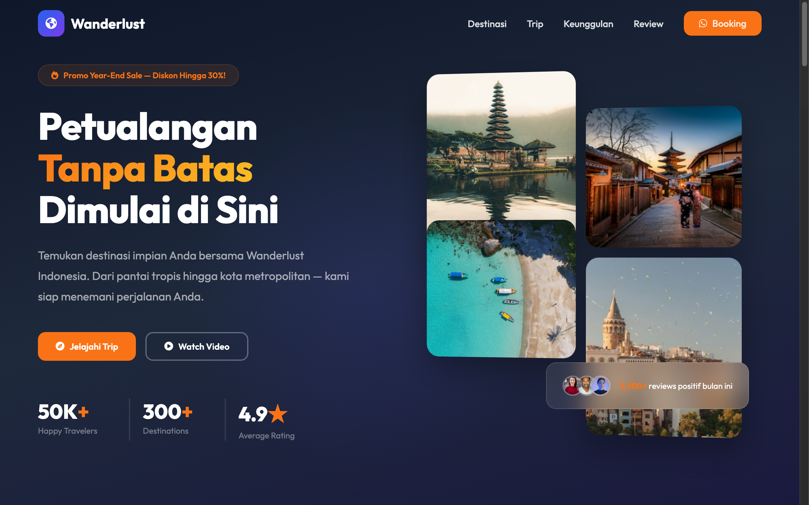

# Wanderlust Indonesia — Premium Travel Experience



A sleek, contemporary travel experience landing page with modern gradients, interactive destination cards, trip discovery filters, and high-conversion itinerary previews.

## Sections

- **Hero & Search Hub**: Eye-catching gradient typography, search filter bar (destination, duration, budget, trip style), and real-time social proof stats.
- **Top Destinations (`#popular`)**: Visual grid of trending travel hotspots (Raja Ampat, Labuan Bajo, Bromo, Bali) with weather and difficulty badges.
- **Featured Trips (`#trips`)**: Categorized trip catalog with interactive filters for Adventure, Leisure, Cultural, and Photography expeditions.
- **Why Choose Us (`#why`)**: Value proposition cards highlighting licensed guides, eco-conscious travel, flexible rescheduling, and 24/7 travel concierge.
- **Traveler Reviews (`#reviews`)**: Carousel of verified guest testimonials with trip ratings and traveler photos.
- **Newsletter & CTA**: Direct trip inquiry form and destination guide download banner.

## Run

Open `index.html` directly in any web browser, or serve locally:

```bash
cd "50. travel-modern" && python3 -m http.server 8000
```

Then open http://localhost:8000.

## Tech

Single-file HTML with modern CSS (flexbox, CSS grid, backdrop-filter glassmorphism, smooth animations) and Vanilla JavaScript. Typography uses Outfit and Sora via Google Fonts; icons from Font Awesome.
