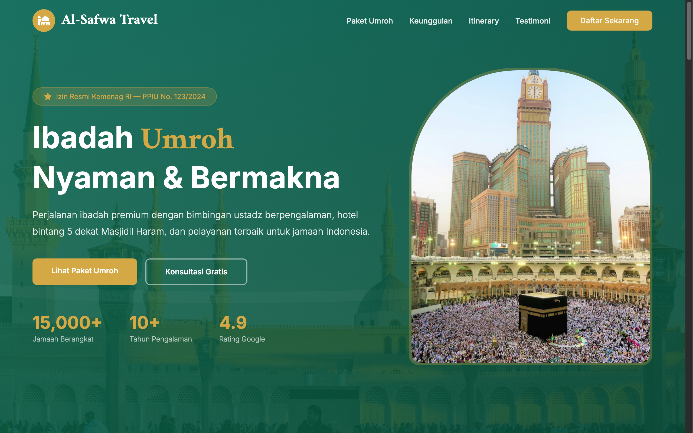

# Al-Safwa Travel — Umroh & Haji Premium



A luxury landing page tailored for high-end Umroh and Haji pilgrimage travel. Designed with an elegant deep emerald (`#0D6B4E`) and golden theme (`#D4A844`), showcasing five-star hospitality in Mecca and Medina, direct flights, and personalized spiritual guidance.

## Sections

- **Hero Banner**: Majestic typography with Arabic calligraphy accents, trust badges (Kemenag accreditation, IATA license), and quick consultation CTA.
- **Paket Ibadah (`#packages`)**: Detailed package comparison cards (Reguler, VIP, Ramadhan, Plus Turki) displaying hotel proximity to Haram, airlines, and all-inclusive pricing.
- **Keunggulan (`#why`)**: Pillars of service excellence (5-star hotels facing the Kaaba, certified Muthawwif scholars, private executive buses, and VIP lounge access).
- **Rundown Perjalanan (`#itinerary`)**: Step-by-step 9-day and 12-day pilgrimage timeline with daily itinerary details.
- **Testimoni Jamaah (`#testimonials`)**: Video and text testimonials from alumni pilgrims.
- **Konsultasi & Pendaftaran (`#contact`)**: Seat reservation form and direct WhatsApp hotline.

## Run

Open `index.html` directly in any web browser, or serve locally:

```bash
cd "51. umroh-premium" && python3 -m http.server 8000
```

Then open http://localhost:8000.

## Tech

Single-file HTML with inline CSS and Vanilla JavaScript. Features interactive package comparison, accordion FAQs, modal booking dialogs, and smooth scrolling. Typography uses Amiri and Inter via Google Fonts; icons from Font Awesome.
