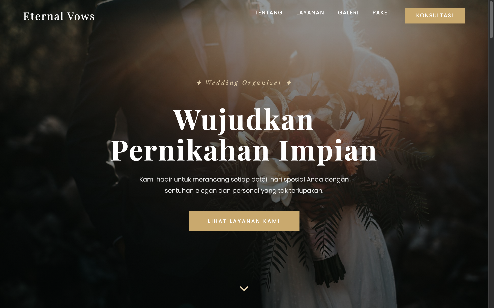

# Eternal Vows — Wedding Organizer



A romantic, soft-palette wedding planning landing page designed for engaged couples seeking elegant, stress-free wedding coordination. Features warm champagne and blush rose accents, photo gallery filters, service packages, and wedding date consultations.

## Sections

- **Hero Header**: Warm cinematic hero section with romantic tagline, consultation booking button, and key statistics (weddings organized, vendor partners, rating).
- **Tentang Kami (`#about`)**: The story, philosophy, and approach behind Eternal Vows wedding styling.
- **Layanan (`#services`)**: Comprehensive coordination services including Full Wedding Planner, Day-of Coordination, Decoration Design, and Engagement Styling.
- **Galeri Portofolio (`#gallery`)**: Photo showcase with category filters (Modern, Traditional, Outdoor, Intimate).
- **Paket & Investasi (`#pricing`)**: Tiered service bundles (Silver, Gold, Platinum) with itemized service deliverables.
- **Konsultasi (`#contact`)**: Interactive date availability checker and consultation booking form.

## Run

Open `index.html` directly in any web browser, or serve locally:

```bash
cd "52. wedding-elegant" && python3 -m http.server 8000
```

Then open http://localhost:8000.

## Tech

Single-file HTML with inline CSS and Vanilla JavaScript. Features interactive lightbox gallery modal, smooth scroll navigation, and form validation. Typography uses Playfair Display and Poppins via Google Fonts; icons from Font Awesome.
