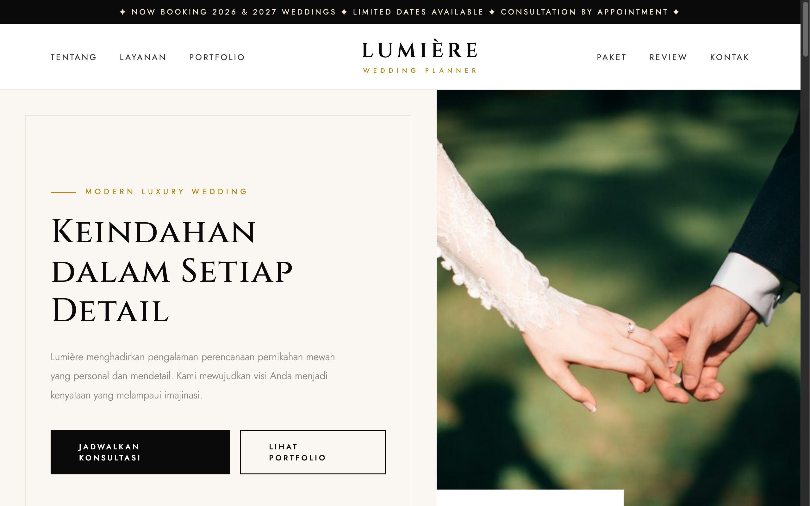

# Lumière Wedding — Modern Luxury Wedding Planner



An haute-couture, dark-and-gold landing page for an exclusive luxury wedding planner. Built with high editorial aesthetics, subtle gold borders, bespoke typography, and high-end wedding curation showcases.

## Sections

- **Hero Experience**: Monochromatic deep dark (`#0A0A0A`) background with metallic gold accents (`#DAA520`), editorial serif header, and private consultation trigger.
- **The Atelier (`#about`)**: Brand vision focusing on architectural floral installations, bespoke ceremony narratives, and sensory event curation.
- **Curated Services (`#services`)**: Tailored service modules covering Haute Scenography, Global Destination Coordination, Bridal Concierge, and Private Culinary Directing.
- **Portfolio Showcase (`#portfolio`)**: High-fashion wedding photo gallery with interactive filters (Grand Ballroom, Coastal Romance, Historic Villas).
- **Investment Tiers (`#pricing`)**: Bespoke pricing tiers (The Signature, The Grand, The Royal) with VIP perks and venue coordination details.
- **Love Letters (`#testimonials`)**: Quotes and press recognition from celebrated clients and luxury publications.

## Run

Open `index.html` directly in any web browser, or serve locally:

```bash
cd "53. wedding-luxury" && python3 -m http.server 8000
```

Then open http://localhost:8000.

## Tech

Single-file HTML with advanced CSS3 (dark theme, gold gradient borders, smooth transitions, mobile responsive grid) and Vanilla JavaScript. Typography uses Cinzel and Jost via Google Fonts; icons from Font Awesome.
