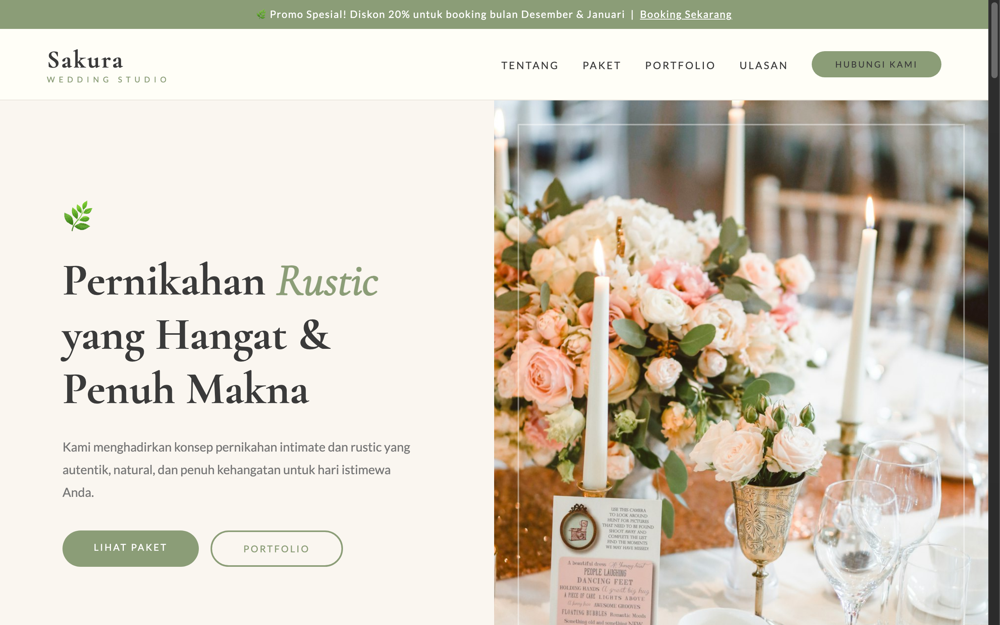

# Sakura Wedding — Intimate & Rustic Wedding



A warm, earthy landing page specialized in intimate, rustic, and botanical garden weddings. Styled with botanical sage green (`#8B9D77`), dusty rose (`#E8C4C4`), and natural terracotta accents (`#C08B6E`).

## Sections

- **Hero & Invitation**: Natural aesthetic header with botanical badges, warm photography, and wedding date reservation button.
- **Filosofi Sakura (`#about`)**: Crafting authentic, unhurried, and deeply personal celebration moments with close family and friends.
- **Paket Pernikahan (`#packages`)**: Intimate packages tailored for 50 to 200 guests (Micro Wedding, Garden Party, Rustic Barn, Semi-Outdoor).
- **Galeri Inspirasi (`#portfolio`)**: Rustic decoration inspirations (wooden arches, fairy lights, dried floral arrangements, vintage furniture).
- **Cerita Pengantin (`#reviews`)**: Authentic reviews and photo snapshots from couples who celebrated intimate nuptials.
- **Konsultasi Gratis (`#contact`)**: Guest count selector, venue preference, and WhatsApp inquiry form.

## Run

Open `index.html` directly in any web browser, or serve locally:

```bash
cd "54. wedding-rustic" && python3 -m http.server 8000
```

Then open http://localhost:8000.

## Tech

Single-file HTML with inline CSS and Vanilla JavaScript. Features interactive package modals, responsive navigation, and smooth reveal transitions. Typography uses Cormorant Garamond and Lato via Google Fonts; icons from Font Awesome.
