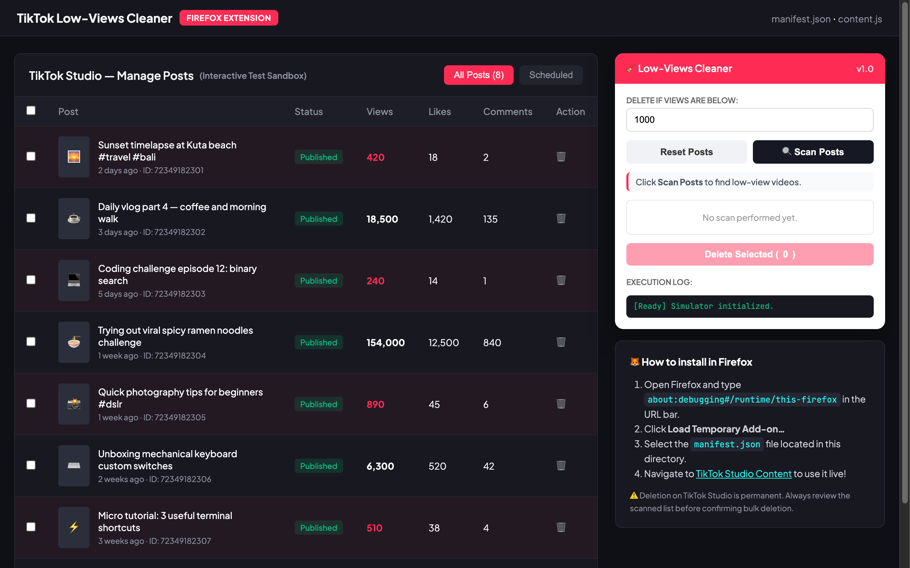

# TikTok Studio Low-Views Cleaner



A browser automation tool and Firefox WebExtension to scan your TikTok Studio video posts and automatically bulk-delete videos with views below a customizable threshold. Includes an interactive test sandbox in `index.html`.

## Features

- **Custom Threshold**: Specify minimum view counts (e.g. `< 1000 views`) to filter underperforming posts.
- **Auto-Scroll & Scan**: Automatically scrolls down your TikTok Studio posts table to discover all published videos.
- **Review Before Deletion**: Displays itemized checkable list with extracted views, titles, and IDs before executing permanent deletion.
- **Throttled Execution**: Implements safe delay pacing (≥ 3000 ms) between actions to prevent rate limiting.
- **Interactive Sandbox**: Test and preview the extension's scanning and bulk-cleanup workflow locally via `index.html`.

## Live Demo & Sandbox

Open `index.html` directly in any web browser to test the cleaner overlay against simulated TikTok Studio post tables:

```bash
cd "55. tiktok-low-views-cleaner" && python3 -m http.server 8000
```

Then open http://localhost:8000.

## Installation in Firefox (Temporary Add-on)

1. Open Firefox and go to `about:debugging#/runtime/this-firefox` in the address bar.
2. Click **Load Temporary Add-on…** and select `manifest.json` in this directory.
3. The extension is active until Firefox closes (repeat when reopening Firefox).

## Usage on TikTok Studio

1. Open [TikTok Studio Content](https://www.tiktok.com/tiktokstudio/content) and log in.
2. The **🧹 Low-Views Cleaner** floating panel appears in the bottom right corner.
3. Enter your minimum view threshold (e.g. `1000`).
4. Click **Muat semua** to auto-scroll and load all posts, then click **Scan**.
5. Review the detected list: check or uncheck individual videos.
6. Click **Hapus terpilih** and confirm to start automated cleanup. Press **Stop** anytime to halt.

## Heuristic Selectors

TikTok Studio frequently updates its DOM structure. If views or rows are not detected:
- **Views index**: If likes/comments are mistaken for views, change the index to 2, 3, etc. and re-scan.
- **Row selector**: Inspect any video row in DevTools and enter its CSS selector (e.g. `[data-tt="components_PostTable_Container"] > div`).
- Check the floating execution log for per-video debug details.

> ⚠️ Deletions on TikTok Studio are permanent. Always inspect the scan list before proceeding.

---

### Panduan Bahasa Indonesia

Ekstensi Firefox untuk menghapus video di TikTok Studio yang total views-nya di bawah angka batas yang ditentukan.

1. Buka Firefox → `about:debugging#/runtime/this-firefox`.
2. Klik **Load Temporary Add-on…** → pilih `manifest.json`.
3. Buka halaman daftar postingan TikTok Studio, tentukan batas views, klik **Scan**, lalu periksa daftar dan klik **Hapus terpilih**.
