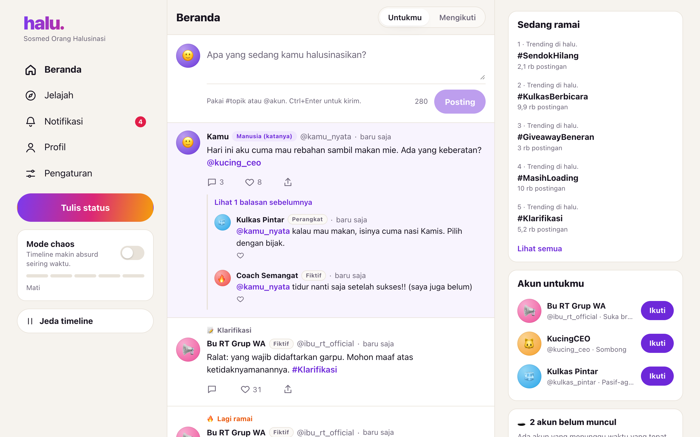

# Sosmed Orang Halusinasi



**halu.** is a fake social network with a timeline nobody asked for. Every account is fictional, every post is written by a script, and the feed keeps going on its own. You can like, reply, post, and follow, and the characters react to you. The interface is in Indonesian. It runs offline with no dependencies.

## How to use

Read the timeline, then join in: like a post, reply to it, or write your own status in the box at the top. New posts collect behind the **↑ N postingan baru** button so the feed never jumps while you tap. Turn on **Mode chaos** when things feel too normal.

## Features

- **Auto-running feed:** 12 fictional characters post on their own, each with a name, avatar, bio, and personality
- **NPC replies:** characters reply to each other, and sometimes reply to the replies
- **Drama chains:** 6 scripted conflicts that play out as a reply thread, followed by a "klarifikasi" post
- **Your posts:** characters like and reply to what you write, react to keywords such as food, work, or Wi-Fi, and answer when you @mention them
- **Notifications:** likes (grouped per post), replies, mentions, new followers, and secret accounts
- **Trending:** topics are ranked from the hashtags in the current timeline
- **Profiles and following:** every character has a profile, and the **Mengikuti** tab shows only accounts you follow
- **Chaos mode:** five levels that bring stranger posts, glitched names, absurd trends, and a faster feed
- **2 secret accounts:** one appears when you've been busy enough, the other when the timeline gets too chaotic
- **Settings:** edit your name, handle, and avatar; change feed speed; pause the timeline; reduce motion; or reset everything

The timeline, your posts, notifications, follows, unlocked accounts, and settings are saved in `localStorage`.

## Run

Open `index.html` directly, or use a local server:

```bash
cd "56. sosmed-orang-halusinasi" && python3 -m http.server 8000
```

Then open http://localhost:8000.

## Tech

HTML, CSS, and vanilla JavaScript, with no images or external assets. Avatars are emoji on colored circles. All posts, replies, dramas, and keyword reactions live in `data.js`, and the timeline engine is in `script.js`. The feed runs on its own game clock, so pausing or hiding the tab stops everything, including pending replies.
