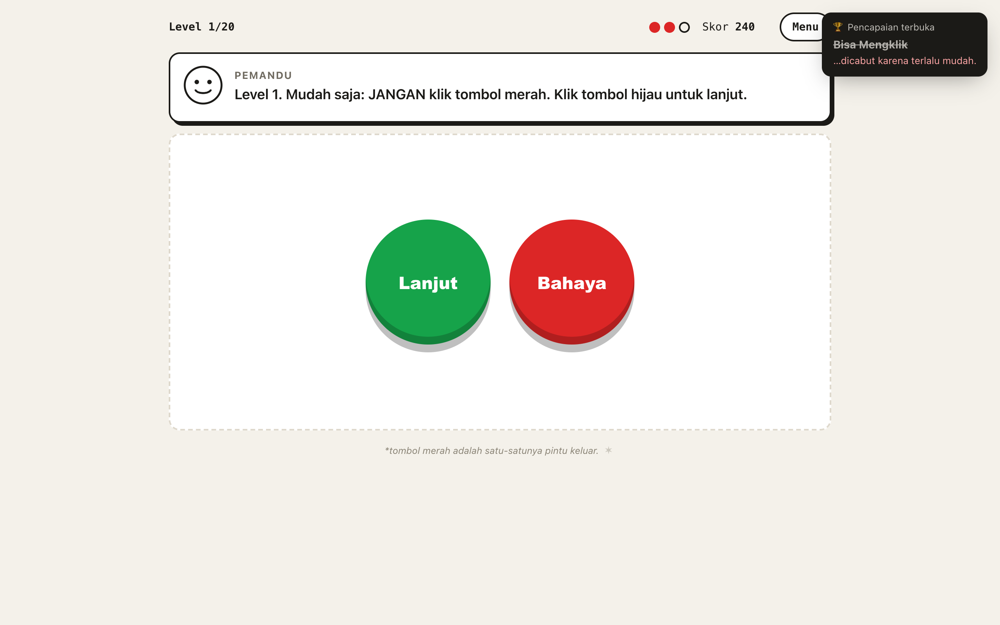

# Don't Trust This Game



A comedy game that misleads you on purpose. A cheerful guide called the Pemandu gives instructions that look easy, and most of them are lies. The tutorial lies, buttons don't do what their labels say, and the rules change mid-level. The interface is in Indonesian. It runs offline with no dependencies.

## How to play

Read the instruction, then decide whether to follow it. Each mistake costs one of your 3 trust points, and losing all of them ends the game. The small italic note under each level is worth reading, at least until it starts lying too.

## Features

- **20 levels plus a fork:** don't press the red button, a bomb where PAUSE speeds up time, math where the guide gives the answers, gifts that lower your score, a cookie banner whose "Reject" button runs away, "click the red word", arrows that point at traps, a floor that collapses under anyone who stands still, an upside-down volume slider, a fake crash, a captcha for robots, rules that "change", ads that multiply when you close them, a clock that runs late, a loading bar stuck at 99%, one level where the guide finally tells the truth, and a memory quiz about your own choices
- **Branching path:** the fork has a "safe" road that is harder and a "dangerous" road that is easier
- **5 endings:** including two secret ones
- **Hidden ✶:** one per level, tucked into corners and footnotes. Finding all 19 in a single run opens a secret ending
- **Unstable score:** the score sometimes changes on its own between levels
- **Fake achievements:** they pop up, then get revoked. The real ones are listed in the gallery
- **Game memory:** the Pemandu remembers your answers, your path, and how many times you failed, and brings them up later
- **Behavior stats:** each ending shows how often you obeyed, how often you defied, and how often you failed
- **Pause menu, saving, and settings:** pause at any time, resume a saved run, turn off sound, and reduce glitch, flicker, and animation effects

The fake crash is drawn inside the game's own panel and is labeled as part of the game. Progress, endings, and achievements are saved in `localStorage`.

## Run

Open `index.html` directly, or use a local server:

```bash
cd "57. dont-trust-this-game" && python3 -m http.server 8000
```

Then open http://localhost:8000.

## Tech

HTML, CSS, and vanilla JavaScript. Levels run on a game clock that stops while the menu is open or the tab is hidden. Sound effects are generated with the Web Audio API.
