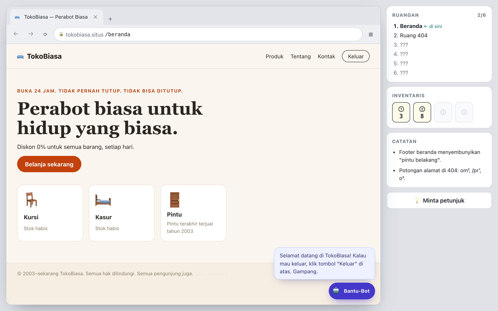

# Escape the Website



A puzzle exploration game set inside a fake browser. You are stuck on TokoBiasa, a perfectly ordinary furniture shop that has never let a single visitor leave since 2003. Every page is a room. Find the clues, collect the pieces of the exit code, and get out. The interface is in Indonesian. It runs offline with no dependencies.

## How to play

Click anything that looks suspicious, read everything, and type addresses straight into the address bar. Some links are fake doors that send you back where you started. Bantu-Bot, the chat helper in the corner, is happy to give advice, and not all of it is true. The hint panel is always honest.

## Rooms

1. **Home:** a normal-looking shop with an almost invisible link
2. **404 Room:** scattered URL fragments to put back together
3. **Pop-up Hell:** close the pop-ups in the right order, or they come back with friends
4. **Archive:** old snapshots of the site hiding a message, one odd word per year
5. **Source Code:** a fake view-source page with a working search box and developer comments, some of them outdated
6. **The Exit:** a keypad that combines every clue

There is also a secret room that is never linked from anywhere.

## Features

- **Fake browser:** a tab, back and forward buttons, reload, an editable address bar, and an internal history list
- **Inventory and notes:** four numbered code pieces plus one secret key, and clues that are written down automatically as you find them
- **NPC that lies:** Bantu-Bot has different lines on every page
- **Randomized code:** the exit code and the order of its pieces are different every game
- **Fake doors:** the "Keluar" button, the contact form, closing the tab, and opening a new tab all lead back to the shop
- **4 endings:** escape, get trapped after three wrong codes, trust the bot, or find the secret ending
- **Hints:** tiered hints for each room, counted in the end-of-game stats
- **Save and continue:** progress and discovered endings are kept in `localStorage`
- **Responsive:** on a phone, the side panel moves below the browser

TokoBiasa and `tokobiasa.situs` are fictional. The game never leaves the page or opens real URLs.

## Run

Open `index.html` directly, or use a local server:

```bash
cd "58. escape-the-website" && python3 -m http.server 8000
```

Then open http://localhost:8000.

## Tech

HTML, CSS, and vanilla JavaScript, with no images or external assets. Every page of the fake site is rendered by `script.js` from a small route table, and internal navigation keeps its own history stack. Glitch effects are kept short and turn off when the system asks for reduced motion.
